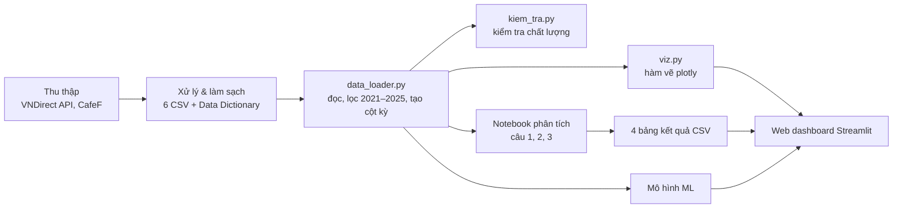

# Khâu Trực quan hóa & Phân tích thống kê trong kiến trúc pipeline

*(Đoạn dùng cho báo cáo GL2 – Thiết kế hệ thống)*

## Vị trí trong pipeline

Pipeline của nhóm gồm năm khâu nối tiếp: Thu thập → Xử lý & làm sạch → Trực quan hóa & Thống kê → Mô hình học máy → Web dashboard. Khâu Trực quan hóa & Thống kê nhận đầu vào là bộ dữ liệu sạch do khâu Xử lý bàn giao (6 file CSV kèm Data Dictionary, nối với nhau bằng khóa `ma_nh` + `quy` + `nam`) và tạo ra hai loại đầu ra: các hàm vẽ biểu đồ và bốn bảng kết quả thống kê. Cả hai đều được web dashboard đọc trực tiếp, nên khâu này đóng vai trò lớp phân tích nằm giữa dữ liệu và giao diện.

## Thành phần

Khâu gồm năm thành phần. `config.py` giữ toàn bộ quy ước dùng chung: thứ tự và bảng màu cố định của 8 ngân hàng và 2 nhóm sở hữu, tên hiển thị và đơn vị của từng chỉ số, giao diện biểu đồ chung. `data_loader.py` là cổng đọc dữ liệu duy nhất: lọc giai đoạn 2021–2025, chuẩn hóa kiểu ngày, tạo cột kỳ `2021Q1` và cung cấp một hàm lọc theo ngân hàng, năm, nhóm dùng chung cho cả notebook lẫn dashboard. `kiem_tra.py` chạy bộ kiểm tra chất lượng trước mỗi lần phân tích (số dòng, trùng khóa, ô trống, 32 giá trị CAR công bố, nhất quán giữa các bảng, công thức lợi suất, ngoại lai). `viz.py` chứa các hàm vẽ bằng plotly; mỗi hàm nhận dữ liệu cùng tham số lọc và trả về một đối tượng biểu đồ, không tự hiển thị hay ghi file. Cuối cùng, notebook phân tích thực hiện thống kê mô tả, xếp hạng, kiểm định giả thuyết và phân tích tương quan, rồi xuất kết quả ra bốn file CSV có cấu trúc cố định.

## Công nghệ

pandas và numpy cho xử lý bảng; plotly làm thư viện vẽ chính vì cùng một biểu đồ vừa dùng được trong Streamlit (tương tác) vừa xuất được PNG cho báo cáo qua kaleido; seaborn/matplotlib dùng bổ trợ cho hình tĩnh. Phần thống kê dùng scipy.stats (Shapiro-Wilk, Levene, t-test, Mann-Whitney U, Pearson, Spearman) và statsmodels (hiệu chỉnh p-value khi kiểm định nhiều chỉ số cùng lúc). Mã nguồn quản lý trên Git/GitHub, chạy trong Jupyter Notebook.

## Giao tiếp với các khâu khác

Với khâu Xử lý: khâu này không sửa dữ liệu gốc. Mọi bất thường phát hiện khi kiểm tra được ghi thành báo cáo và gửi lại người phụ trách làm sạch. Với web dashboard: hai bên thống nhất trước hợp đồng giao tiếp gồm tên và tham số của hàm vẽ, bảng màu, và cấu trúc cột của bốn file kết quả (`thong_ke_mo_ta.csv`, `xep_hang_nam.csv`, `kiem_dinh_nhom.csv`, `tuong_quan.csv`). Nhờ vậy dashboard có thể dựng song song từ khung bảng rỗng và tự cập nhật khi dữ liệu hoặc kết quả thay đổi. Với khâu Mô hình học máy: hai khâu dùng chung `data_loader.py`, nên mô hình và phân tích thống kê luôn làm việc trên cùng một phiên bản dữ liệu và cùng giai đoạn.
