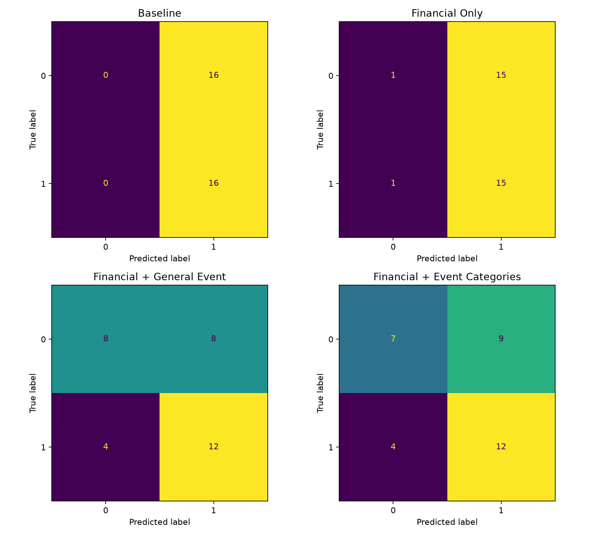
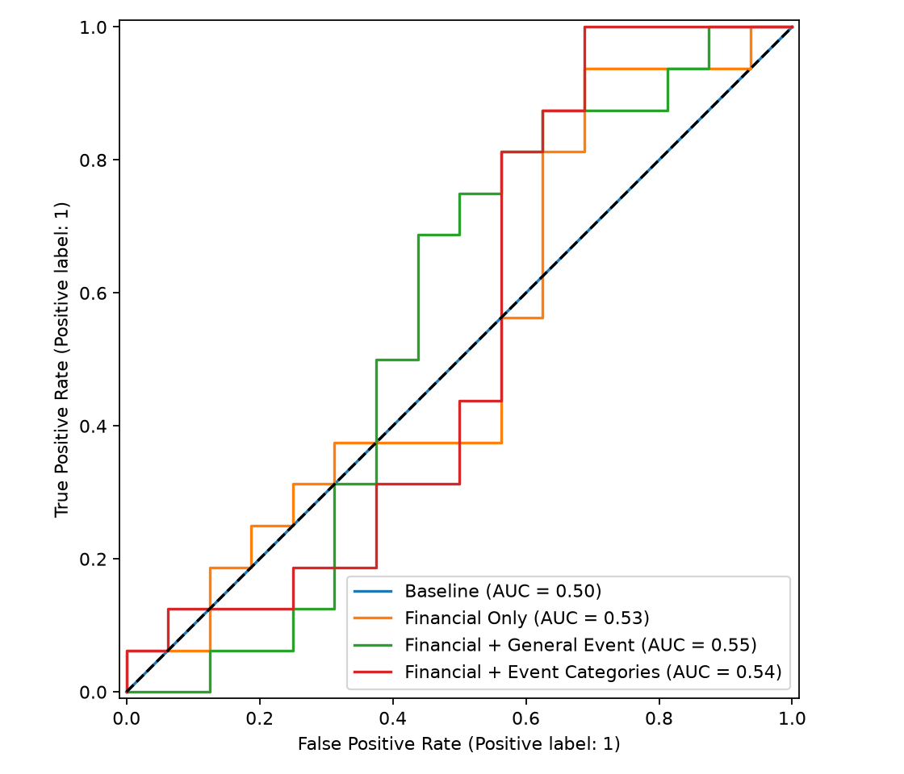
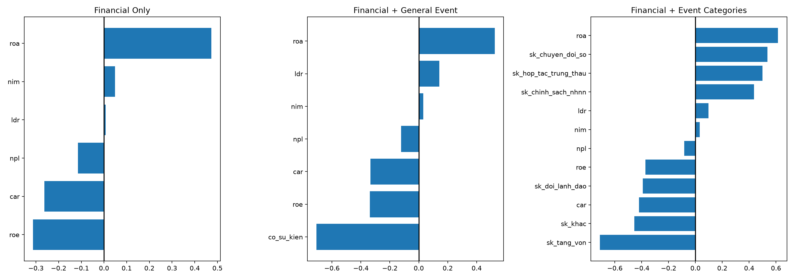
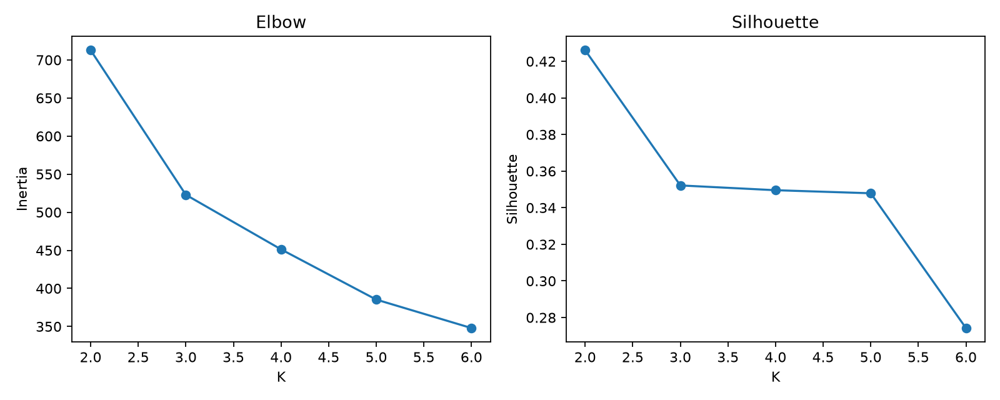
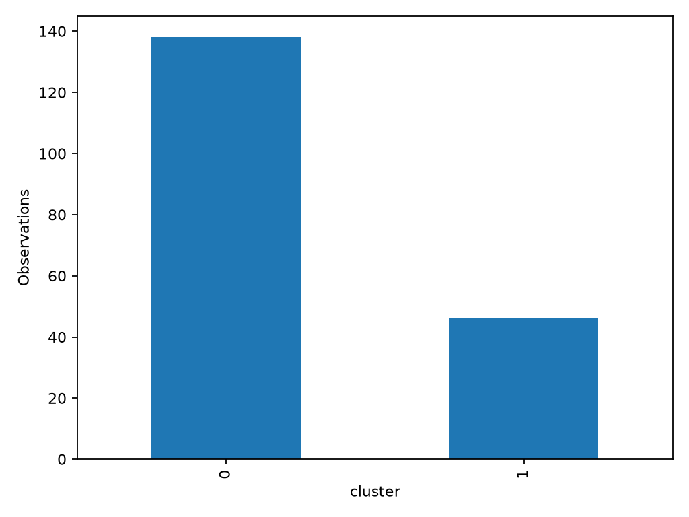
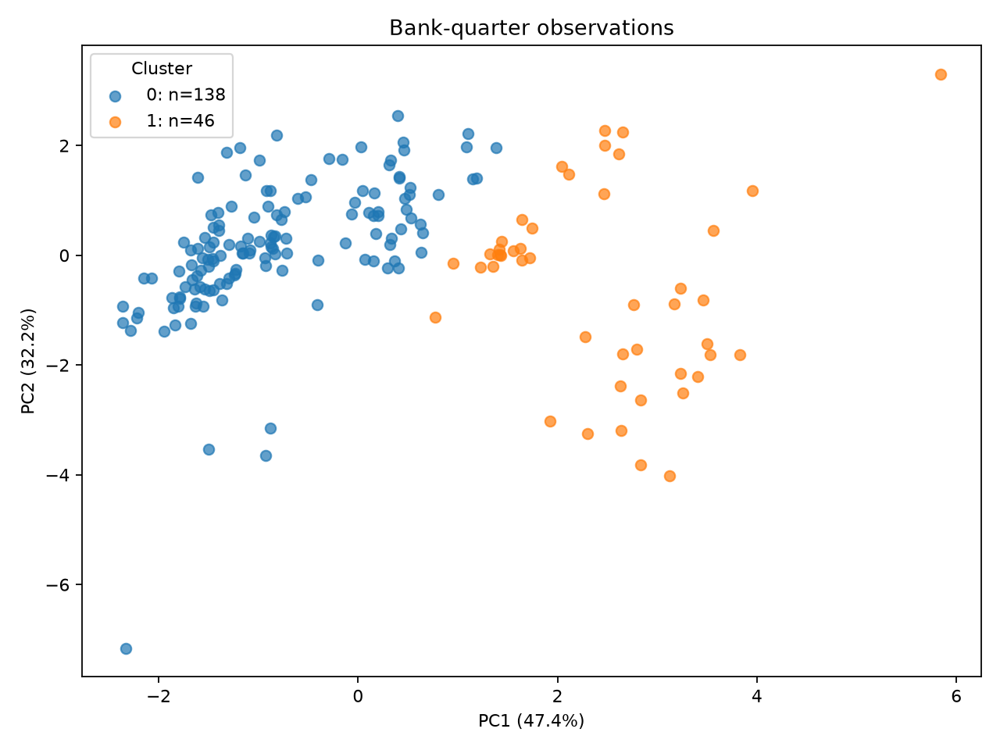

# Kết quả Machine Learning

## 1. Data Readiness

READY FOR ML với bản CAR dự báo theo dictionary; 184 quan sát, 8 ngân hàng, 2021–2026. Không thay CSV gốc. Train 128; Test 32. Xem [Data Readiness](data_readiness_report.md).

## 2. Logistic Regression

| Model | Features | Accuracy | Precision | Recall | F1 | ROC-AUC |
|---|---|---|---|---|---|---|
| Baseline | - | 0.5 | 0.5 | 1.0 | 0.6667 | 0.5 |
| Financial Only | roa, roe, nim, npl, car, ldr | 0.5 | 0.5 | 0.9375 | 0.6522 | 0.5312 |
| Financial + General Event | roa, roe, nim, npl, car, ldr, co_su_kien | 0.625 | 0.6 | 0.75 | 0.6667 | 0.5547 |
| Financial + Event Categories | roa, roe, nim, npl, car, ldr, sk_tang_von, sk_chuyen_doi_so, sk_hop_tac_trung_thau, sk_doi_lanh_dao, sk_chinh_sach_nhnn, sk_khac | 0.5938 | 0.5714 | 0.75 | 0.6486 | 0.5352 |

Mặc định L2, C=1, ngưỡng 0.5; không tuning trên Test. Chỉ 6 biến tài chính được chuẩn hóa bằng Train; event giữ đơn vị tự nhiên (cờ/đếm), nên hệ số event không so trực tiếp magnitude với hệ số financial. Model 2A chọn cờ có sự kiện để tránh trùng thông tin với count. Model 2B giữ đủ 6 loại; hai loại chỉ có 2 quan sát Train nên hệ số dễ bất ổn. Regularization hỗ trợ nhưng không khắc phục thiếu thông tin.

| Model | delta_Accuracy | delta_F1 | delta_ROC-AUC |
|---|---|---|---|
| Financial + General Event | 0.125 | 0.0145 | 0.0234 |
| Financial + Event Categories | 0.0938 | -0.0035 | 0.0039 |

Hệ số dương/âm biểu thị liên hệ cùng/ngược chiều với log-odds nhóm tăng, có điều kiện trên các biến khác trong mô hình; không chứng minh nhân quả. Hệ số và hướng chi tiết ở logistic_coefficients.csv. Financial standardized: một đơn vị là một độ lệch chuẩn Train.

## 3. K-Means

| K | Inertia | Silhouette | smallest_cluster |
|---|---|---|---|
| 2 | 712.7807 | 0.4261 | 46 |
| 3 | 522.9397 | 0.3522 | 23 |
| 4 | 451.3009 | 0.3496 | 9 |
| 5 | 385.3383 | 0.3479 | 9 |
| 6 | 347.9599 | 0.2743 | 9 |

Chọn K=2: silhouette cao nhất trong 2–6, đối chiếu đường inertia và profile dưới đây. Đây là quy tắc có thể tái lập; elbow chỉ mang tính bổ trợ, không khẳng định có điểm gãy rõ. Nhóm không được chọn bằng target hoặc Test performance. Fit scaler toàn bộ 184 mẫu cho mục đích mô tả; không dùng cụm/PCA để dự báo.

| cluster | roa | roe | nim | npl | car | ldr | observations | description |
|---|---|---|---|---|---|---|---|---|
| 0 | 1.551 | 19.261 | 3.365 | 1.502 | 10.306 | 102.296 | 138 | CAR thấp tương đối / LDR thấp tương đối |
| 1 | 2.475 | 16.066 | 5.422 | 2.744 | 14.915 | 129.541 | 46 | CAR cao tương đối / LDR cao tương đối |

Tên cụm theo hai độ lệch chuẩn lớn nhất so với trung bình toàn mẫu; “cao/thấp” là tương đối trong dataset, không phải xếp hạng chất lượng ngân hàng. Phân cụm các ngân hàng-quý, không phải 8 ngân hàng cố định. Số ngân hàng-quý theo ngân hàng:

| ma_nh | 0 | 1 |
|---|---|---|
| ACB | 23 | 0 |
| BID | 23 | 0 |
| CTG | 23 | 0 |
| MBB | 23 | 0 |
| STB | 23 | 0 |
| TCB | 0 | 23 |
| VCB | 23 | 0 |
| VPB | 0 | 23 |

Cluster_over_time và cluster_transitions cho thấy thay đổi theo thời gian; số cụm là nhãn tùy ý, không có thứ bậc. CAR phân cụm là CAR gốc đã được nhóm điền theo nguồn.

## 4. PCA

| PC | explained_variance_ratio | cumulative |
|---|---|---|
| PC1 | 0.4736 | 0.4736 |
| PC2 | 0.3221 | 0.7957 |

| Feature | PC1 | PC2 |
|---|---|---|
| roa | 0.4247 | 0.4754 |
| roe | 0.0562 | 0.6611 |
| nim | 0.5182 | 0.0375 |
| npl | 0.2362 | -0.5336 |
| car | 0.5162 | -0.0552 |
| ldr | 0.475 | -0.2188 |

PCA dùng chính ma trận standardized của K-Means. Bảng trên là components_ (hệ số vector thành phần); dấu PC tùy quy ước. Hai chiều chỉ là phép chiếu, các cụm có thể chồng lấn và không thể hiện toàn bộ khoảng cách 6 chiều.

PC1: đóng góp mạnh theo trị tuyệt đối: nim (0.518), car (0.516), ldr (0.475). Không gán nhãn kinh tế vượt quá loadings.

PC2: đóng góp mạnh theo trị tuyệt đối: roe (0.661), npl (-0.534), roa (0.475). Không gán nhãn kinh tế vượt quá loadings.

## 5. Research Question Answers

**RQ1:** Financial Only đạt Accuracy 0.500, F1 0.652, ROC-AUC 0.531 trên 32 mẫu Test 2025; cần đối chiếu baseline trong bảng. Đây là khả năng quan sát trong một năm kiểm tra, chưa chứng minh tính tổng quát.

**RQ2:** Chênh lệch khi thêm event được tính ở bảng delta phía trên. Các chỉ số không đồng thời cải thiện ở cả hai phiên bản; chưa đủ bằng chứng khẳng định cải thiện ổn định. Với 32 mẫu, một dự đoán khác làm Accuracy thay đổi 3.125 điểm %. Không chọn phiên bản “tốt nhất” dựa trên Test để triển khai.

**RQ3:** 2 cụm tài chính mô tả theo profile thực tế ở trên, gồm CAR thấp tương đối / LDR thấp tương đối; CAR cao tương đối / LDR cao tương đối.

## 6. Limitations

- Chỉ 184 quan sát, 8 ngân hàng, giai đoạn 2021–2026; các quan sát cùng ngân hàng và cùng quý phụ thuộc nhau.
- Test chỉ năm 2025, chưa có validation qua nhiều năm; chưa có khoảng tin cậy hay kết luận ý nghĩa thống kê về cải thiện.
- Event hiếm, nguồn tin và phân loại có thể thiếu; không âm thầm bỏ hoặc gộp loại.
- CAR công bố theo năm, giá trị điền tiếp tạo nhiều quý lặp lại; chưa có nguồn manual trong project để kiểm chứng độc lập.
- Financial VNDirect có thể là bản sau soát xét/kiểm toán; giả định BCTC biết ở +45 ngày chưa kiểm tra bằng ngày công bố thực tế.
- Giá điều chỉnh có thể được điều chỉnh hồi tố; chưa có snapshot giá point-in-time.
- Logistic chỉ thể hiện association, không causality. Nhãn là lợi suất giữa hai mốc +45 ngày, không phải lợi suất quý lịch.
- K-Means phụ thuộc khoảng cách, outlier và giả định cụm dạng cầu; PCA 2D mất một phần thông tin.

## 7. Đọc sâu kết quả và kiểm chứng diễn giải

Financial Only có F1 0.652, so với baseline 0.667; AUC 0.531 gần mức ngẫu nhiên 0.5. Vì vậy khả năng dự báo hiện tại yếu. Model event tổng quát tăng Accuracy nhưng chưa vượt baseline về F1; Model categories không cải thiện F1 so với financial only.

Financial + Event Categories: các financial có |hệ số| lớn nhất: roa +0.615 (cùng chiều), car -0.421 (ngược chiều), roe -0.373 (ngược chiều). Đây là liên hệ có điều kiện, không phải tác động nhân quả.

Financial + General Event: các financial có |hệ số| lớn nhất: roa +0.525 (cùng chiều), roe -0.338 (ngược chiều), car -0.334 (ngược chiều). Đây là liên hệ có điều kiện, không phải tác động nhân quả.

Financial Only: các financial có |hệ số| lớn nhất: roa +0.473 (cùng chiều), roe -0.313 (ngược chiều), car -0.262 (ngược chiều). Đây là liên hệ có điều kiện, không phải tác động nhân quả.

Có 0 lần chuyển cụm giữa các quý liên tiếp trong toàn bộ panel. Cụm 0: ACB 23 mẫu, BID 23 mẫu, CTG 23 mẫu, MBB 23 mẫu, STB 23 mẫu, VCB 23 mẫu. Cụm 1: TCB 23 mẫu, VPB 23 mẫu. Phân cụm chủ yếu phản ánh khác biệt cố hữu giữa ngân hàng, chưa chứng minh trạng thái tài chính biến đổi rộng theo thời gian.

K=2 có silhouette 0.426; cụm nhỏ nhất ở các K khác: K=3 23 mẫu, K=4 9 mẫu, K=5 9 mẫu, K=6 9 mẫu. Đường inertia tiếp tục giảm nhưng tách thêm cụm kém gọn và khó bảo vệ trên dataset nhỏ. Cụm 1 (CAR cao tương đối / LDR cao tương đối, 46 mẫu) so với cụm 0: ROA, NIM, NPL, CAR, LDR cao hơn; ROE thấp hơn. Đây là trung bình cụm, không gọi cụm nào là “tốt hơn”.

PC1 có NIM, LDR, CAR cùng dấu và đóng góp mạnh; mô tả trục đồng biến ba tỷ lệ này, không gọi chung là “tốt hơn”. PC2 chủ yếu đối chiếu ROE/ROA dương với NPL âm; hỗ trợ cách đọc lợi nhuận tương đối đối lập nợ xấu trong phép chiếu này. Điểm lệch xa nhất theo PC2 là STB Q4/2025 (cụm 0, PC2 = -7.16); không xem mọi điểm cùng cụm là đồng nhất.
